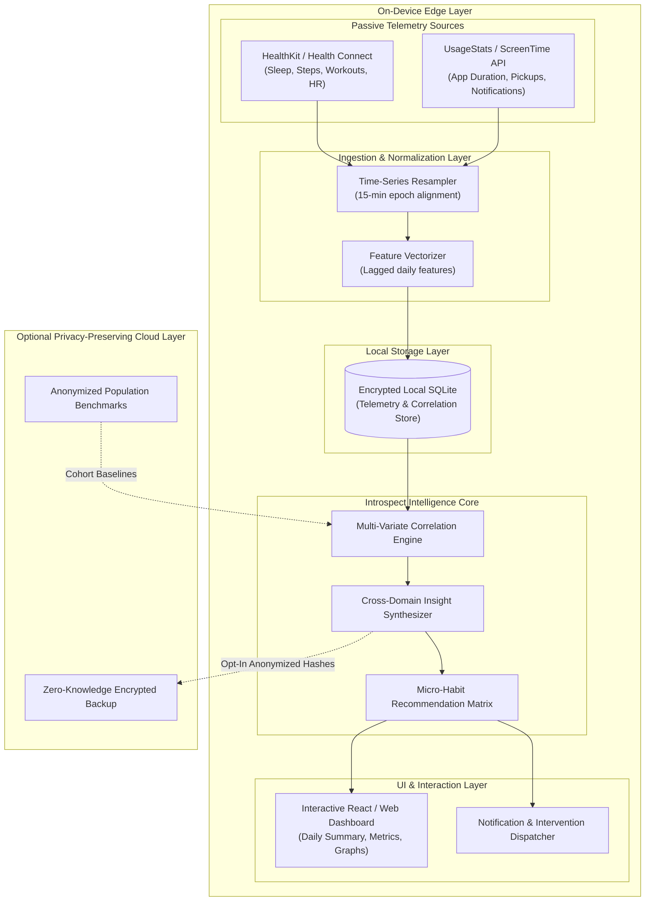

# FILE: architecture.md
##################################################

# System Architecture

## 1. High-Level Overview

INTROSPECT is an edge-first Personal Intelligence System designed to bridge the chasm between physical health telemetry and digital behavior telemetry. The architecture emphasizes **local execution**, **zero-latency multi-variate correlation**, and **privacy by design**.

---

## 2. Component Breakdown

### A. Passive Telemetry Ingestion Pipeline
- **Frequency**: Background worker triggered every 30 minutes or on OS broadcast triggers (e.g. device charging, unlock).
- **Time Alignment**: Converts raw timestamped events into normalized 15-minute time epochs to allow direct cross-referencing between screen usage events and biometric signals.

### B. On-Device SQLite Store
- Holds 90 days of rolled-up personal telemetry.
- Encrypted via OS-level hardware-backed keystore (iOS Keychain / Android Keystore).
- Contains partitioned tables for raw events, daily aggregates, computed correlation coefficients, and scheduled interventions.

### C. Cross-Domain Intelligence Engine
- **Pearson & Spearman Rank Correlation Evaluators**: Computes bidirectional correlation coefficients across paired metric streams:
  - Screen Time $\leftrightarrow$ Sleep Duration
  - Workout Intensity $\leftrightarrow$ Deep Sleep Latency
  - Late-Night Screen Consumption $\leftrightarrow$ Next-Day Activity Drag
- **Anomaly & Threshold Detectors**: Identifies habit spikes (e.g. $>1\text{ hr}$ phone use after 11:00 PM).
- **Natural Language Insight Synthesizer**: Converts statistical outputs into plain-language, non-judgmental explanations paired with single-action recommendations.

### D. Presentation & Intervention Dispatcher
- Provides an ultra-responsive dark-mode user interface.
- Sends proactive scheduled interventions (e.g. triggering bedtime downtime reminders 30 minutes before habitual sleep latency drops).

