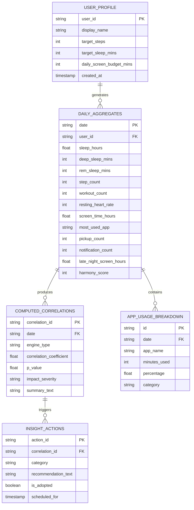

# Data Model & Storage

INTROSPECT employs a hybrid storage strategy: a rich on-device SQLite database for privacy-centric computation, and an optional end-to-end encrypted cloud schema for backup and cross-device sync.

---

## 1. Entity-Relationship Diagram (On-Device SQLite)



---

## 2. SQL Schema Definitions (SQLite)

```sql
-- Daily Aggregate Rollups
CREATE TABLE IF NOT EXISTS daily_aggregates (
    date TEXT PRIMARY KEY,
    user_id TEXT NOT NULL,
    sleep_hours REAL NOT NULL,
    deep_sleep_mins INTEGER DEFAULT 0,
    rem_sleep_mins INTEGER DEFAULT 0,
    step_count INTEGER NOT NULL,
    workout_count INTEGER DEFAULT 0,
    resting_heart_rate INTEGER,
    screen_time_hours REAL NOT NULL,
    most_used_app TEXT,
    pickup_count INTEGER DEFAULT 0,
    notification_count INTEGER DEFAULT 0,
    late_night_screen_hours REAL DEFAULT 0.0,
    harmony_score INTEGER,
    created_at TIMESTAMP DEFAULT CURRENT_TIMESTAMP
);

-- Computed Cross-Domain Correlations
CREATE TABLE IF NOT EXISTS computed_correlations (
    correlation_id TEXT PRIMARY KEY,
    date TEXT NOT NULL,
    engine_type TEXT NOT NULL,
    correlation_coefficient REAL,
    p_value REAL,
    impact_severity TEXT CHECK(impact_severity IN ('High Impact', 'Recovery Pattern', 'Actionable Routine', 'Milestone Achieved')),
    summary_text TEXT NOT NULL,
    explanation_text TEXT NOT NULL,
    FOREIGN KEY(date) REFERENCES daily_aggregates(date) ON DELETE CASCADE
);

-- Actionable Interventions
CREATE TABLE IF NOT EXISTS insight_actions (
    action_id TEXT PRIMARY KEY,
    correlation_id TEXT NOT NULL,
    category TEXT NOT NULL,
    recommendation_text TEXT NOT NULL,
    is_adopted INTEGER DEFAULT 0,
    scheduled_time TEXT,
    created_at TIMESTAMP DEFAULT CURRENT_TIMESTAMP,
    FOREIGN KEY(correlation_id) REFERENCES computed_correlations(correlation_id)
);
```

---

## 3. Cloud Storage Layer (Optional Zero-Knowledge Sync)

When cloud sync is enabled by the user:
- Records are encrypted on-device with AES-256-GCM using a user-derived key before transmission.
- The cloud backend cannot inspect app names, biometric values, or timestamps.
- Only zero-knowledge cryptograms and aggregated non-identifiable telemetry vectors are persisted in PostgreSQL.

