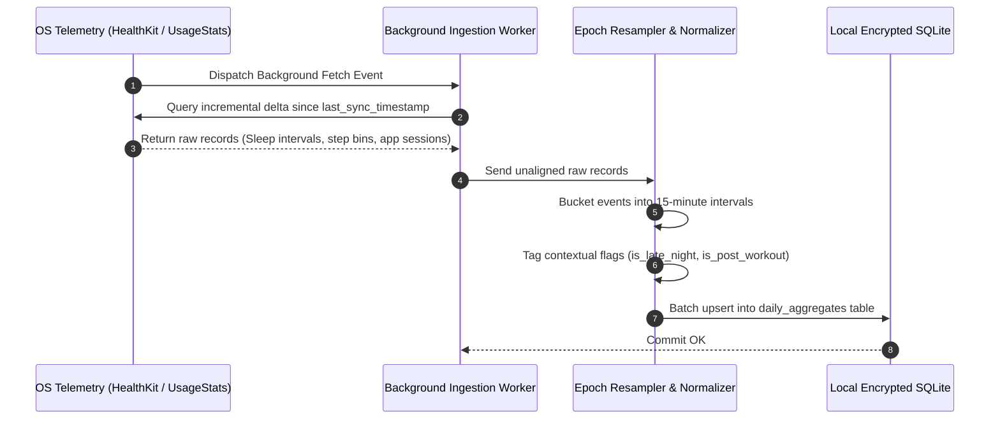

# FILE: data-sources.md
##################################################

# Data Sources Specification

INTROSPECT collects telemetry exclusively through native smartphone and wearable OS frameworks. It requires **no manual journaling** and **no proprietary hardware sensors**.

---

## 1. Inventory of Data Sources

| Domain | Data Stream | Native OS API / Source | Polling Interval | Target Metrics Fed |
| :--- | :--- | :--- | :--- | :--- |
| **Physical** | Sleep Stages & Duration | Apple HealthKit (`HKCategoryTypeIdentifierSleepAnalysis`) / Android Health Connect | Daily on wake-up event | Sleep Deficit Engine, Circadian Alignment Engine |
| **Physical** | Step Count & Cadence | Apple CoreMotion (`CMPedometer`) / Android SensorManager (`TYPE_STEP_COUNTER`) | Hourly batch (15-min bins) | Activity Momentum Engine, Next-Day Drag Engine |
| **Physical** | Exercise & Workouts | HealthKit (`HKWorkoutTypeIdentifier`) / Google Fit Activity Recording API | Real-time on workout end | Exercise-Sleep Synergy Engine |
| **Physical** | Resting Heart Rate (RHR) | HealthKit (`HKQuantityTypeIdentifierRestingHeartRate`) / Wearable PPG | Every 4–6 hours | Recovery & Physiological Stress Index |
| **Digital** | Screen Time & App Usage | iOS DeviceActivity Framework / Android `UsageStatsManager` | 30-min background sync | Cognitive Load Engine, Habit Clustering Engine |
| **Digital** | Phone Pickups & Unlocks | iOS Screen Time API / Android `ACTION_USER_PRESENT` Broadcast | Event-driven count | Interruption Frequency Engine |
| **Digital** | Notification Volume | Android `NotificationListenerService` / iOS UserNotifications (aggregate counts) | Hourly batch | Attention Fragmentation Score |
| **Digital** | Late-Night Screen Usage | Filtered subset: Screen active between 23:00 and 06:00 | Daily summary post-sleep | Pre-Sleep Melatonin Inhibition Engine |

---

## 2. Ingestion & Pre-Processing Flow

---

## 3. Battery & Permission Management

- **Zero Foreground Drain**: Ingestion hooks execute during system maintenance windows and when the phone connects to AC power overnight.
- **Permission Tiering**:
  - *Tier 1 (Core)*: HealthKit / Health Connect sleep & step permissions.
  - *Tier 2 (Digital)*: Screen Time / Usage Access permission.
  - *Tier 3 (Opt-in)*: Notification counts and workout categorizations.

