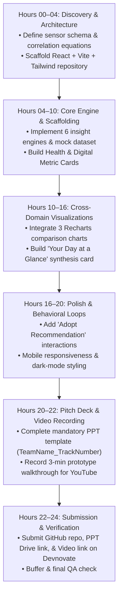

# Hack Day Plan (24-Hour Build Plan)

## 1. Team Roles & Responsibilities

| Team Member | Role | Primary Focus |
| :--- | :--- | :--- |
| **Member 1** | **Frontend & UI/UX Lead** | React dashboard, Tailwind dark theme, responsive layout, Recharts data visualization. |
| **Member 2** | **Data & Intelligence Lead** | Correlation algorithms, mock data pipeline, data models, insight engine heuristics. |
| **Member 3** | **Product & Pitch Lead** | Presentation slide deck (PPT template), 3-minute video pitch recording, Devnovate submission. |

---

## 2. 24-Hour Execution Timeline

---

## 3. Submission Checklist (Devnovate Requirements)

- [x] **Mandatory Template & Drive Link**: File named `TeamName_TrackNumber`, public viewing access enabled.
- [x] **Public GitHub Repository**: Working prototype codebase with clean README and documentation.
- [x] **Video Pitch (3–5 minutes)**: Clear problem statement, proposed solution, technical approach, and prototype walkthrough uploaded to YouTube.
- [x] **Team Details**: Filled out completely on Devnovate platform.
