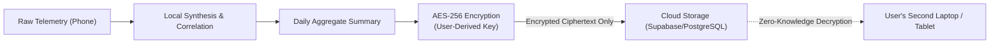

# Privacy & Security Model

## Core Principle: "Your Data Stays on Your Glass"

The central design requirement of INTROSPECT is that highly sensitive personal telemetry—which apps you open in bed, how often you check your phone, and your resting heart rate—should **never be commercialized or harvested**.

---

## 1. Local vs. Cloud Boundary

| Data Stream | Processed On-Device? | Sent to Cloud? | Encryption Method |
| :--- | :--- | :--- | :--- |
| **Raw App Usage Names** | ✅ Yes | ❌ Never | Never exported |
| **Notification Content / Sender Names** | ✅ Yes (Counters only) | ❌ Never | Ephemeral in-memory |
| **GPS / Location Details** | ❌ Not collected | ❌ Never | N/A |
| **Continuous Heart Rate Beats** | ✅ Yes (Resampled to hourly RHR) | ❌ Never | Device Keystore |
| **Multi-Variate Correlation Calculations** | ✅ Yes (Processed locally) | ❌ Never | Local SQLite |
| **Daily Aggregate Summary (Optional Backup)** | ✅ Yes | ⚠️ Opt-in only | AES-256-GCM Zero-Knowledge |
| **Population Cohort Benchmark** | ❌ No | ✅ Read-only baseline | Public read-only |

---

## 2. Zero-Knowledge Cryptographic Architecture

- **Keys Owned Exclusively by the User**: Decryption keys are derived from the user's master biometric or passphrase and stored in the secure hardware enclave (Secure Enclave on iOS, Titan/Trusty on Android).
- **Zero Server-Side Visibility**: Cloud servers have zero access to the cryptographic keys and cannot inspect raw behavioral patterns.

---

## 3. User Controls & Data Sovereignty

1. **One-Tap Data Purge**: Users can permanently erase all historical correlation tables and logs from their device in one tap.
2. **Selective Sensor Toggles**: Any data stream (e.g. App Names or Heart Rate) can be isolated or muted without disabling the remaining engines.
3. **Data Export**: Full export available at any time in standardized `.json` and `.csv` formats.
4. **No Third-Party Analytics Trackers**: No third-party ad SDKs or user tracking frameworks are embedded in the client application.

